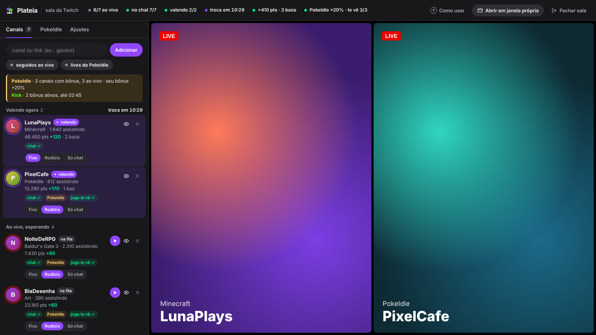
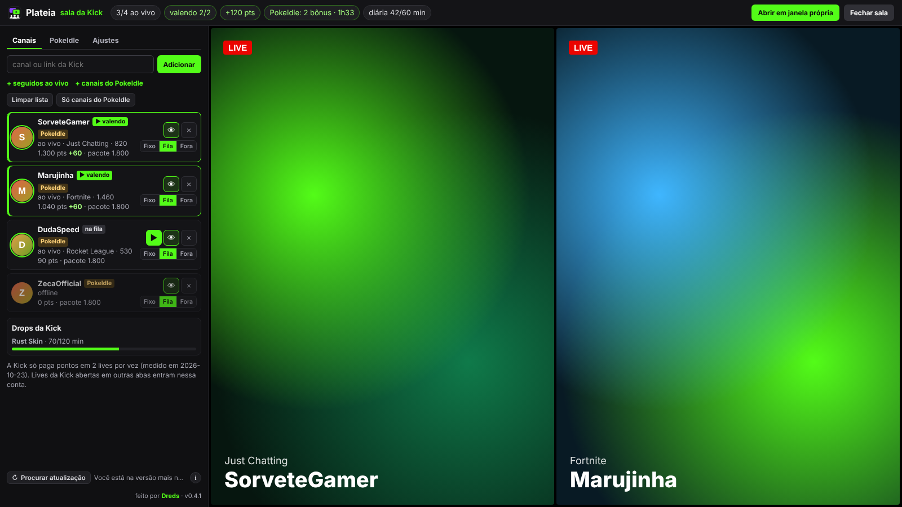
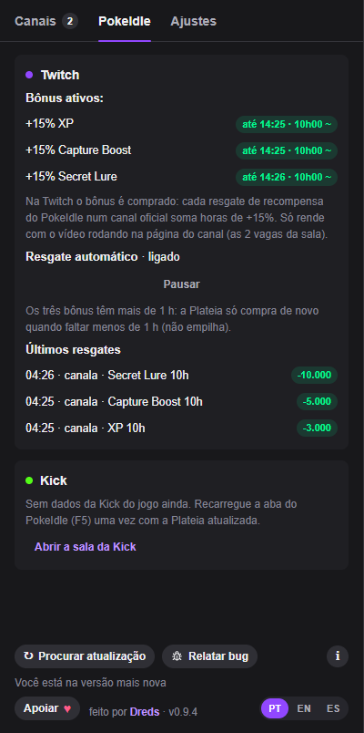
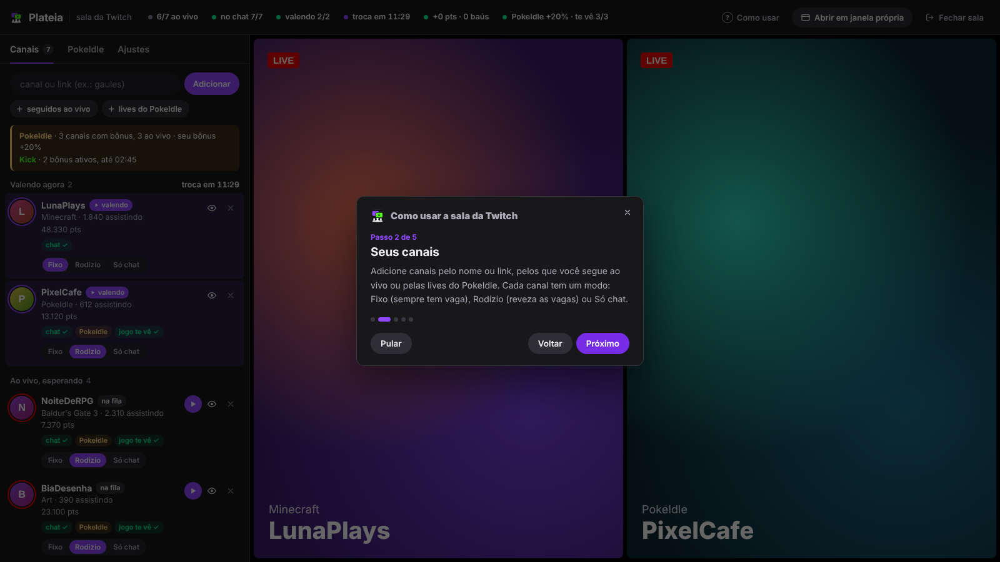
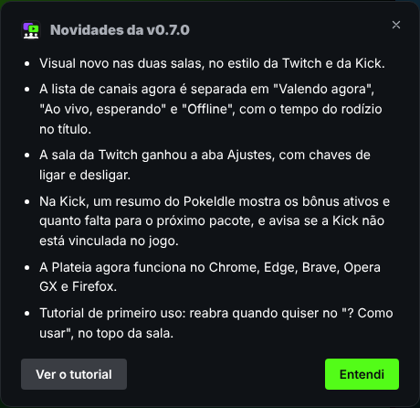
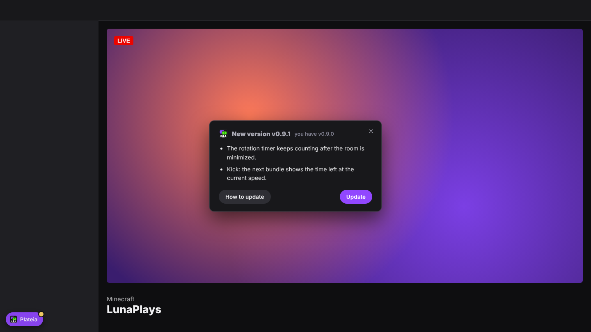
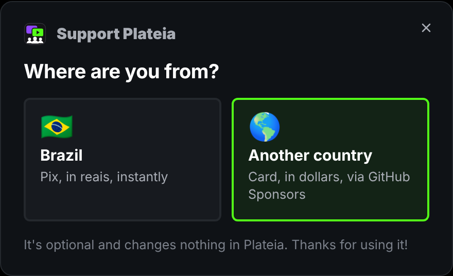
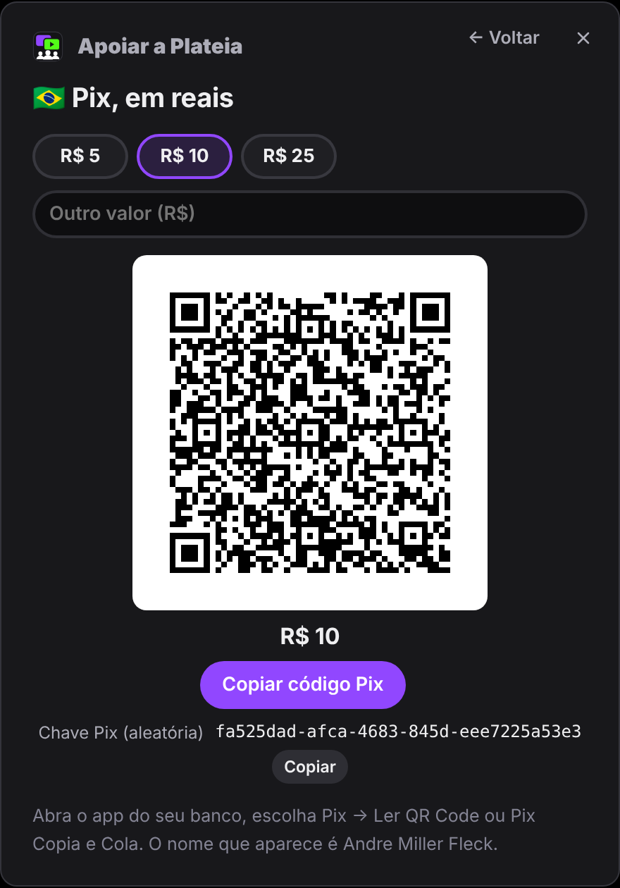
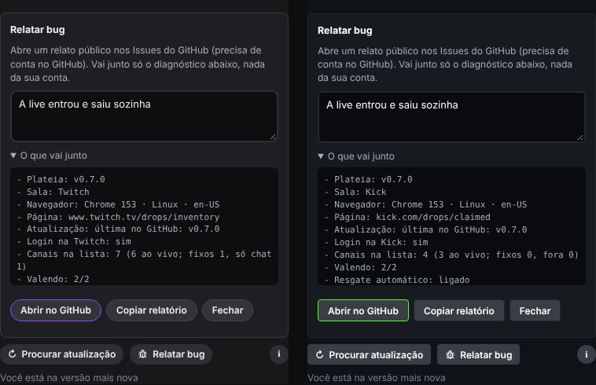
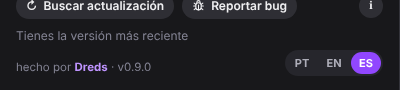

<div align="center">


# Plateia

**Your seat in every stream at once.**
A browser extension for **Twitch and Kick**. It grabs the Twitch channel-points chest by itself, claims finished Drops on both sites, and puts several lives in one room. On Twitch you're present in every chat; on Kick it saves channel points and redeems them for you.


**Works on:** Chrome · Edge · Brave · Opera GX &nbsp;·&nbsp; **Languages:** Português · English · Español



<sub>The Twitch room with demo channels (simulated Twitch, Kick and PokeIdle, made-up names).</sub>

</div>

---

## What it does

The extension knows which site it's on. **Twitch** and **Kick** each get their own room (purple button on Twitch, green on Kick), styled like the site it runs on. Both rooms have the same tabs: **Channels**, **PokeIdle** and **Settings**, and the channel list is split into *Earning now* (with the rotation timer), *Live, waiting* and *Offline*.

### Twitch

- **Chest on autopilot.** On any Twitch tab, and on every live inside the room, it clicks the *+50* bonus chest as soon as it shows up (0.4–2 s random delay). It looks for the chest icon, not the button text, so it works in any language.
- **Drops on autopilot.** The room checks your inventory every 2 minutes. A Drop at 100% is claimed directly; if that fails, it opens the inventory page hidden and clicks *Claim* there.
- **Multi-live room.** A purple **Plateia** button on Twitch opens the room in its own window:
  - **Presence in every chat.** One IRC connection, using the site's own login, joins the chat of every channel on your list (in batches, inside Twitch's join limit). You show up in the viewer list without loading any video.
  - **2 lives that count.** Twitch only pays points and chests on 2 streams at a time, so 2 slots play for real: the full channel page in an iframe, muted, at 160p. The eye button hides a live without reloading it (it keeps counting).
  - **Rotation.** Slots rotate between the channels that are live every N minutes (20 by default, 10 minimum), so every channel earns at some point. Each channel can be **Fixed** (always gets a slot), **Rotation** or **Chat only**, and **▶** puts one on screen right now.
  - **Live counters:** live/total, in chat X/Y, earning 2/2, time to the next swap, points and chests since the room opened, balance per channel, Drops in progress.
- **Keeps counting minimized.** Chrome pauses any video that never played with sound once its window is hidden, and the room's lives are always muted, so a minimized room used to stop earning (Twitch paused the lives, Kick stopped counting watch time). In the room's lives only, Plateia now keeps the page "visible" to the site, runs its timers on a Worker so they aren't throttled, and gives each live an inaudible sound touch (volume 0.0001 for an instant, then muted again) so Chrome doesn't pause it. Your volume isn't changed. If the browser refuses sound before any click, the room shows **"Click the room to keep counting minimized"**; one click anywhere in the room is enough.
- **Add channels** by name or link, from the channels you follow that are live, or from the game below. **Clear list** (asks for a second click) and **PokeIdle channels only** start the list over.
- **Settings tab** (*Ajustes*), in three groups with on/off switches: number of slots, rotation on/off, minutes per round, 160p for the room's lives; chat presence and follow PokeIdle's channels; chest and Drops on autopilot.
- **PokeIdle bonus.** Since 2026-11-04 [PokeIdle](https://pokeidle.io) sells its Twitch bonus for channel points, like its Kick one: each redemption of a PokeIdle reward on an official channel adds hours of +15% (XP, Capture Boost or Secret Lure), and the hours add up. Just sitting in the chat no longer earns anything, and the points only come with the video playing on the channel page. With the game open in a tab, Plateia reads the official channels and the end time of each bonus from the game itself (read only, it never sends anything to the game) and keeps those channels on the list.
- **Automatic bonus redemption** (v0.9.4). For each of the three bonuses Plateia buys the **10 h** reward, in this order: XP (3,000), Capture Boost (5,000), Secret Lure (10,000), one at a time and only when that channel's balance covers it. It does it by **clicking the page's own points panel inside the room's live** (the hidden 2×2 px iframe), not by calling the redemption API: open the panel, click the reward, click *Redeem*. Guard rails:
  - only on official channels with the rewards active, only with the game linked to **the same Twitch account** that is open, and only with game data from the last 30 minutes;
  - it checks the reward's exact name (with the "(10h)" suffix) and its cost in the list **and** on the *Redeem* button before clicking, and never buys above 10,000 points;
  - it only buys a bonus with **less than 1 hour left** (no stacking), using the end time the game reports and its own redemption log;
  - one purchase at a time with a random 3–5 s pause, a lock so two calls (or two open rooms) make one purchase, and it pauses on an urgent release;
  - it confirms by the effect (the channel balance dropped by the cost, or the "<login> redeemed ..." line showed up in the chat); any error (button gone, different name or cost, balance didn't drop) **stops everything for 15 minutes** and the PokeIdle tab shows why;
  - an on/off switch in Settings (*Resgate automático do bônus*, on by default) and a Pause button in the PokeIdle tab.

### Kick

Kick has no chest to click: points drop by themselves (10 every 5 minutes watched), they only work on the channel where you earned them, and only **2** lives earn at a time (measured, same as Twitch).

- **Room with 2 slots in focus mode.** The channels closest to completing a PokeIdle bundle play first, so bundles close sooner. Each channel can be **Fixed**, **Queue** or **Off**; **▶** pins one right now.
- **Bundle redemption.** When a channel's balance covers **one of each** PokeIdle reward (XP + Capture Boost + Secret Lure), it redeems the three in a row through the site's own endpoint. Guard rails: only with Kick linked inside the game, only if the game is linked to the same Kick account, only full bundles (all three rewards active), stops on the first error and waits 15 minutes.
- **PokeIdle summary** at the top of the channel list: official channels live, active bonuses with their end time, and how many points are left for the next bundle (with a time estimate). It warns when Kick isn't linked in the game or the game is linked to another Kick account, because redemption stays off in both cases.
- **Daily Reward and Drops.** Claims Kick's Daily Reward after the hour watched, and finished Drops when the game account is connected.
- **Settings tab:** number of slots, automatic bundle redemption, follow PokeIdle's Kick channels, Daily Reward and Drops on autopilot. Each one can be turned off.

### PokeIdle tab





- **Twitch:** active bonuses with their end time (a `~` means estimated from Plateia's own redemptions), the next purchase and how many points each channel still needs, the latest redemptions and, if redemption stopped, why and until when.
- **Kick:** active bonus hours (until when), bundle progress per channel with a time estimate, last redemptions.

<sub>Kick room with demo data (simulated Kick and PokeIdle, made-up names); PokeIdle tab from the end-to-end test on a simulated Twitch.</sub>

### Tutorial, what's new and update notices

They show up by themselves, centered on the Twitch or Kick page you're on: no need to open the room or click the extension icon. They don't darken or block the page, and they close with the X or Esc.



- **First run** in a browser: a short tutorial (5 steps for each site), with **Skip** and **Got it**, plus **Open the room** on the last step. It doesn't come back by itself; **? How to use** at the top of the room reopens it.
- **After an update**, the first page you open shows **What's new in vX.Y.Z**, once per version (if you skipped versions, it lists each one, up to the last 4). The texts live in `extension/src/changelog/` (`pt.js`, `en.js`, `es.js`) and are updated on every version.



- **New version on GitHub**: a **New version vX.Y.Z** box with what changed (read from that release's changelog, in your language) and an **Update** button that does the right thing for your browser. It appears the moment Plateia finds the release, on the page you already have open, no reload. The X only snoozes it: it comes back after 1 hour or the next time you open the browser, until you update.
- **Urgent version**: when a release title has **URGENTE**, the box has no X and Plateia pauses its automation (chests, Drops, Kick redemptions, the room's streams and chat) until you update.



### Support button

<p align="center">
  
  &nbsp;
  
</p>

- **Support ♥** sits in the footer of both rooms, before the "made by Dreds" signature. It never opens by itself and changes nothing in Plateia.
- **Brazil:** Pix in reals, R$ 5, 10, 25 or any amount. The BR Code is built locally (static, CRC16-CCITT) and drawn as a QR with [qrcode-generator](https://github.com/kazuhikoarase/qrcode-generator) (MIT, bundled with its license), with a **Copy Pix code** button.
- **Another country:** opens [GitHub Sponsors](https://github.com/sponsors/DredsGG) in a new tab.
- No new permission and no network call from the dialog; nothing about who donates is stored.

## How it was measured

Before writing the room I measured how Twitch actually behaves, on a live account:

- The bonus chest is `.claimable-bonus__icon` inside `[data-test-selector="community-points-summary"]`, and it can be clicked from inside an iframe of the same site.
- A full `twitch.tv/<channel>` page inside an iframe on twitch.tv loads logged in and earns points. The official embed player (`player.twitch.tv`, used by most multi-stream sites) **doesn't**.
- With 4 lives open, only **2** earned points. A live in a 2×2 px iframe still earns points and chests.
- Drops progress on one channel at a time, so the room doesn't try to speed them up.
- On Kick, 4 lives playing for 11 minutes: only **2** earned points. `kick.com/<channel>` can be framed by a kick.com page, so the room works the same way.
- The points panel works inside a 2×2 px hidden iframe of the channel page: the widget mounts, the panel opens with every reward, the detail screen shows *Redeem <cost>*, and a click buys. The reward's name is the `alt` of its image (the button has no `aria-label`) and the cost is in `.reward-icon__cost`. The widget takes 10–15 s to appear after the page loads. The PokeIdle rewards are, per bonus: 1 h, 3 h, 5 h and 10 h, all +15%, at 300 / 900 / 1,500 / 3,000 (XP), 500 / 1,500 / 2,500 / 5,000 (Capture Boost) and 1,000 / 3,000 / 5,000 / 10,000 (Secret Lure).
- PokeIdle's Kick bonus is bought: each redemption of a PokeIdle reward on an official channel is 1 hour of +15%, and hours add up (from the game's own client code).

## Architecture

```
extension/
├── manifest.json            MV3 for Chrome, Edge, Brave and Opera GX: background as service_worker, permissions storage and alarms
├── COMO-INSTALAR.html       install / use / update guide (PT, EN and ES) with a browser picker, opens on first install
├── src/fundo.js             background: update check against this repo's releases (plus that release's changelog),
│                            reload when the folder changes,
│                            site-permission check (users can limit the extension's site access)
├── src/comum.js             shared: chrome API, language (detect, switch, translate), settings, storage, cookie login,
│                            page-like fetch, GQL helper
├── src/i18n/                English and Spanish texts (en.js, es.js), keyed by the Portuguese text
├── _locales/                extension description in each language
├── src/bau.js               every Twitch frame: clicks the chest; on the inventory page, claims Drops
├── src/sala.js              the Twitch room (shadow DOM): channel data, IRC presence, slots, rotation, Drops
├── src/twitch-resgate.js    automatic PokeIdle bonus redemption on Twitch: clicks the points panel inside the room's live,
│                            guard rails, redemption log, and the bonus/next-purchase math used by the PokeIdle tab
├── src/kick/kick.js         Kick: button, room, focus-mode slots, bundle redemption, Daily Reward, Drops
├── src/pix.js               Pix BR Code for the Support dialog (static, CRC16-CCITT), no network
├── src/vendor/qrcode.js     qrcode-generator 2.0.4 (MIT, license next to it) to draw the Pix QR
├── src/visivel.js           page world, room lives only: keeps them playing and counting while the window is hidden
├── src/ui.js                shared UI and the room style per site: logo, icons, tutorial, what's new and new-version
│                            notices (on the site page and in the room), update card, bug report, footer signature,
│                            language selector
├── src/changelog/           what's new per version (pt.js, en.js, es.js)
├── src/pokeidle-painel.js   the PokeIdle tab used by both rooms
├── src/pokeidle-ponte.js    pokeidle.io, page world: reads the game's twitch and kick blocks from its WebSocket (read only)
├── src/pokeidle-guarda.js   pokeidle.io: stores those blocks for the rooms
└── icons/
```

- No popup: everything lives inside the site. The only background piece is the small update script.
- One code base for Chrome, Edge, Brave and Opera GX (Manifest V3, `chrome.*`); network calls go out like the page itself, and SVG icons are built without `innerHTML`.
- Channel data comes from Twitch's own GraphQL endpoint with aliased queries, batched 10 per request (Twitch rejects more than 15 aliases).
- The room's players are forced to 160p only while they load, then your usual quality setting is restored.
- Chat presence heals itself: a JOIN that Twitch drops is retried after 30 s, every channel is re-checked each minute, and a silent chat connection is reopened after 6 minutes.
- Kick calls use the site's own login (the `session_token` cookie) from inside kick.com.

## Updates



While Twitch or Kick is open, Plateia checks this repo's latest release by itself: when the browser starts, when a page opens, every 30 minutes, and whenever you come back to the tab (at most once every 10 minutes). **↻ Check for updates** in either room is only a backup. A new version shows the **New version** box on the Twitch or Kick page (see above), a gold card in the room footer and a gold dot on the Plateia button. **Update** downloads the zip, and once you extract it **over the same folder** Plateia notices the new `manifest.json` within a minute and reloads itself (only the room tabs reload; your other Twitch and Kick tabs keep running). **Later** in the room card (or the X on the box) snoozes it for 1 hour. The **i** button opens the install and update guide.

## Reporting a bug

**Report bug**, in the footer of both rooms next to the update check, opens a prefilled issue in this repo with the version and a short diagnostic: browser, room, counts and on/off states only (no account name, token or channel names). You can read exactly what goes along before sending, or use **Copy report** instead.

## Install

One package for the four browsers. Get it from the [latest release](https://github.com/DredsGG/plateia/releases/latest).

### Chrome, Edge, Brave, Opera GX

1. Download **plateia-vX.Y.Z.zip** and extract it to a folder you'll keep.
2. Open the extensions page: `chrome://extensions`, `edge://extensions`, `brave://extensions` or `opera://extensions`.
3. Turn on **Developer mode** (top right; on Edge it's in the left column) and keep it on: the self-reload after an update needs it.
4. Click **Load unpacked** and pick that folder. From a clone of this repo, load the `extension/` folder.
5. To update, extract the new version over the same folder, or press **Update** on the new-version box or in the room's update card.

On **Opera GX**, if Plateia disappears after you close the browser (a known Opera issue with unpacked extensions), just load the folder again.

If the Plateia button doesn't show up, check the extension's site access in the browser's extensions settings: it has to allow twitch.tv and kick.com (the install guide also shows an *Allow access* button when this is missing).

### After installing

Reload twitch.tv or kick.com and click the **Plateia** button (bottom left: purple on Twitch, green on Kick). For PokeIdle, reload the game tab once so Plateia can read the official channels. `COMO-INSTALAR.html` (opens on first install, in Portuguese, English and Spanish) has the same steps with a browser picker.

## Languages



- Everything is in **Portuguese, English and Spanish**: both rooms, the footer, the tutorial, what's new, the new-version box, warnings, the bug report and the install guide.
- The first time, Plateia uses your browser language (any other language falls back to English). Switch it any time with **PT · EN · ES** in the room footer, or the flags in the install guide; the choice is saved and shared by both.
- Plateia keeps its own dictionary (`extension/src/i18n/en.js`, `es.js`) keyed by the Portuguese text, because `chrome.i18n` can't switch language while the extension is running.
- New text goes into all three at once: `teste-idiomas.cjs` fails if any UI string is missing a translation.

## Known limitations

- Twitch and Kick only pay points on **2 lives at a time** (measured), so only 2 slots play for real; the other channels get chat presence on Twitch and nothing on Kick.
- Drops progress on one channel at a time, so the room doesn't speed them up.
- A real Drop claimed at 100% hasn't been seen live yet; the logic is covered by the tests. The Kick bundle redemption was confirmed live on v0.9.1 (1,800 points spent on XP + Capture + Lure).
- On Chrome, Edge, Brave and Opera GX the self-reload after an update needs **Developer mode** to stay on.
- PokeIdle features need the game open in a tab (reload it once after installing Plateia). Bundle redemption only runs with Kick linked inside the game.

## Tests

```bash
cd tests && npm i jsdom
node teste-sala.cjs         # Twitch room logic in jsdom: 30/30
node teste-kick.cjs         # Kick room: bundle, order, guard rails, PokeIdle summary, Daily Reward, Drops, tab, bug report, urgent pause, ULID redemption id, no double purchase: 24/24
node teste-chat.cjs         # dropped chat JOIN is retried: 3/3
node teste-assinatura.cjs   # footer signature and version: 6/6
node teste-rodape.cjs       # footer: update check, bug report without personal data, signature: 10/10
node teste-quadros.cjs      # first-run tutorial and what's new (skipped versions too), both rooms: 14/14
node teste-avisos.cjs       # notices on the Twitch/Kick page: tutorial, what's new, new version, X snoozes 1 h, urgent pause: 38/38
node teste-fundo.cjs        # background: 30-min check, 10-min floor for page requests, URGENTE releases, snooze reset: 10/10
node teste-idiomas.cjs      # every UI string in en/es, browser-language detection, both rooms in pt/en/es, selector: 35/35
node teste-apoio.cjs        # Support dialog: Pix codes match the reference, CRC, amounts and limits, footer order, never opens by itself, copy with and without clipboard, Esc/X/outside, focus trap, no network, pt/en/es, Kick: 44/44
node teste-visivel.cjs      # minimized room: Worker timers, page stays visible, sound touch refused -> click -> ok, your volume intact, site sees no events, room hint: 22/22
node teste-twitch-resgate.cjs # automatic PokeIdle redemption on Twitch against a fake points panel (list, detail, Redeem) inside the room's lives: order XP -> Capture -> Lure, no balance, wrong name or cost, no stacking, error stops 15 min (also after reopening), one purchase for concurrent calls and for two rooms, urgent pause before and mid-cycle, switch off / Pause, same-account lock, official channels only, 10,000 cap, the game's block in the new and old formats, pt/en/es: 67/67
node rodar-todos.cjs        # runs every teste-*.cjs and adds up the OK / FAILED lines: 303 OK

# needs Playwright; pass a COPY of the extension folder (the test rewrites its manifest)
node e2e-atualizacao.mjs /path/to/copy-of-extension   # update flow: 10/10
node e2e-regra14.mjs ../extension /tmp <pt-BR|en-US|es|fr>   # notices and languages in real Chromium, per browser language: 19 checks each
node e2e-insistente.mjs /path/to/copy-of-extension /tmp     # page already open: new release, snooze and return, back-to-tab check, URGENTE pause until updated: 16/16

node e2e-apoio.mjs ../extension /tmp/out              # Support dialog in real Chromium: prints in pt/en/es on both paths, Esc closes, Sponsors opens in a new tab, no network

# automatic redemption in real Chromium with the extension loaded and a FAKE Twitch (all network intercepted, no real point is spent): three purchases in order, hidden 2x2 px lives, wrong reward name stops, no stacking: 13 checks
PW_DIR=/path/with/node_modules/playwright ./e2e-twitch-resgate.sh ../extension /tmp/out   # the .sh opens Chrome and connects over CDP (on Windows Node can't spawn Playwright's chrome.exe); without CDP the .mjs launches Chromium itself

# the other E2E scripts import the launcher in pw.mjs (same idea). On Windows: PW_DIR=... ./e2e-cdp.sh <extension or a copy of it> e2e-regra14.mjs /tmp/out pt-BR  (LANG_CHROME=<language> sets the browser language)

# manifest and files check: valid MV3 manifest, service_worker only, no browser_specific_settings, every cited file exists,
# permissions are only storage and alarms, every __MSG_*__ exists, node --check on every .js
node checar-manifest.cjs ../extension
```

`e2e-atualizacao.mjs` loads the real extension in Chromium against a fake GitHub release: the guide opens on install, the gold card shows the versions and notes, *Update* opens the zip, the dot appears on the button, *Later* hides it, and writing a newer `manifest.json` into the folder makes Plateia reload itself (15 s) with the green "updated" notice.

`teste-sala.cjs` covers the PokeIdle bridge and storage, GQL batching, settings migration, per-channel modes, *watch now*, removed channels not coming back, list clearing, and the footer. The room was also run end to end in Chromium with the extension loaded against a simulated Twitch and PokeIdle, and on a real account in my Chrome (chat 12/12, a chest claimed by the rotation). Claiming a real Drop at 100% hasn't been seen live yet. The Kick room was run on a real account (live status, balances, Daily Reward and Drops read, 2 lives playing); a real bundle redemption hasn't happened yet.

## Disclaimer

Personal project, not affiliated with or endorsed by Twitch, Kick or PokeIdle. It doesn't fake viewing: lives that earn points are real players playing video. Automating clicks and redemptions may still go against Twitch's or Kick's Terms of Service. Use it on your own account and at your own risk.

## Support

Plateia is free. If it helps you, there's an optional **Support ♥** button in the room: Pix for Brazil or [GitHub Sponsors](https://github.com/sponsors/DredsGG) from anywhere else.

## License

[MIT](LICENSE) · made by [André Miller Fleck (Dreds)](https://github.com/DredsGG)
