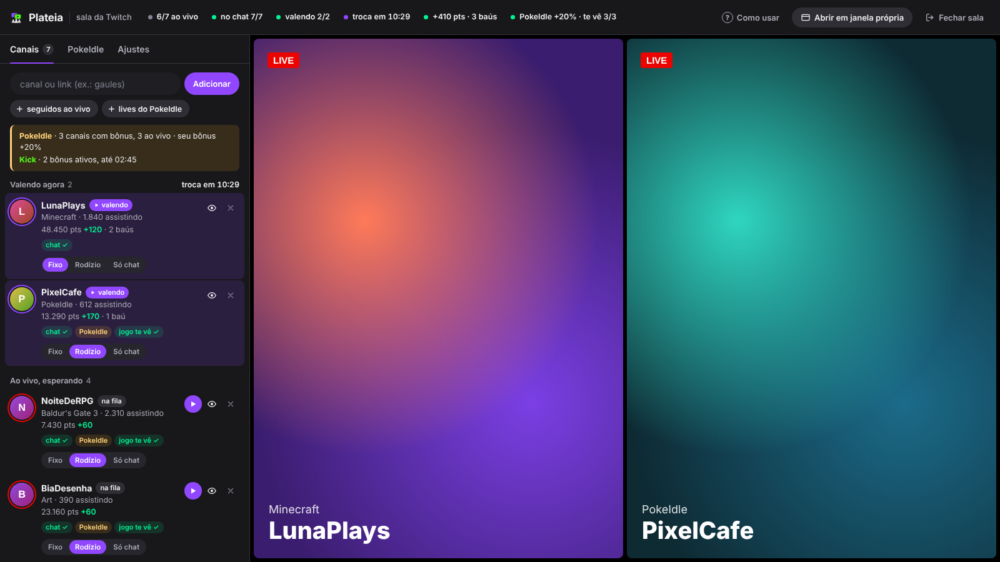
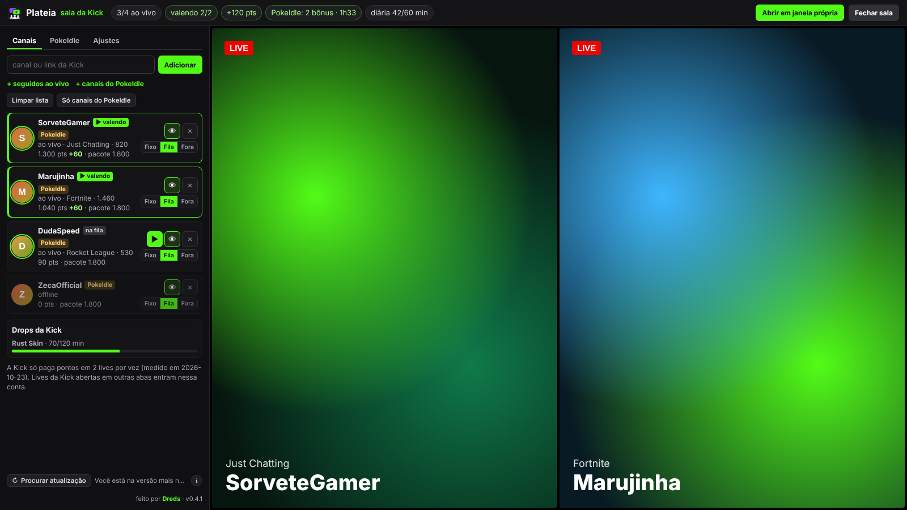
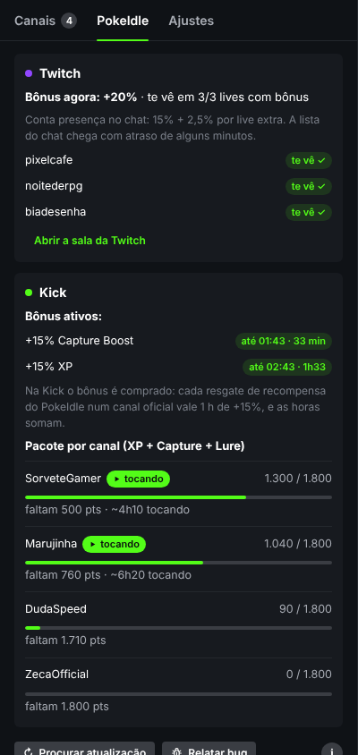
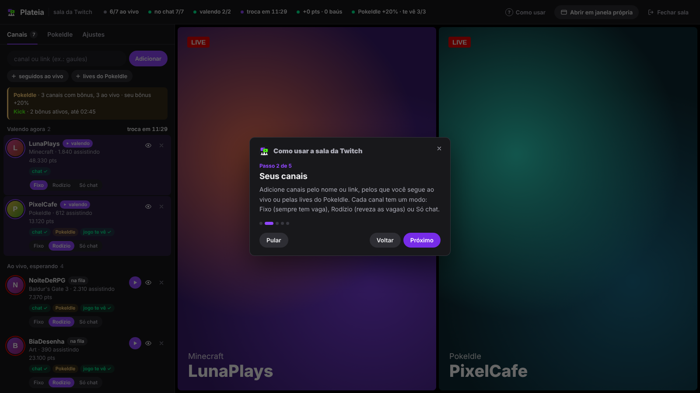
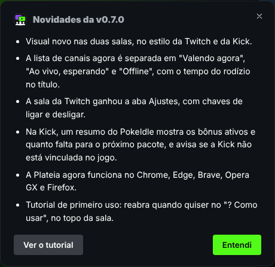
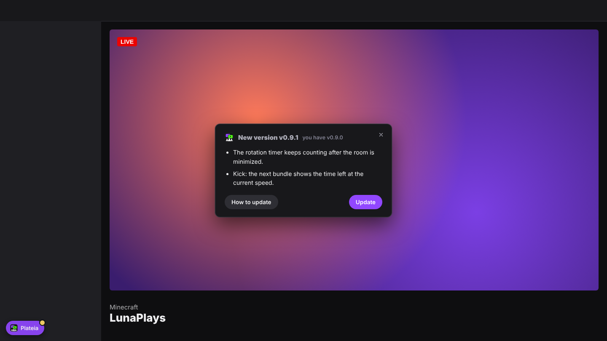
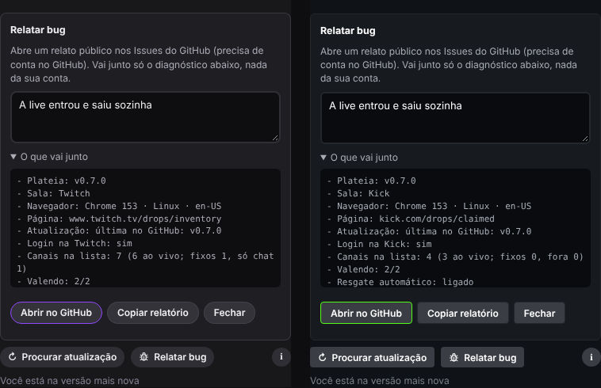
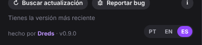

<div align="center">


# Plateia

**Your seat in every stream at once.**
A browser extension for **Twitch and Kick**. It grabs the Twitch channel-points chest by itself, claims finished Drops on both sites, and puts several lives in one room. On Twitch you're present in every chat; on Kick it saves channel points and redeems them for you.


**Works on:** Chrome · Edge · Brave · Opera GX · Firefox 140+ &nbsp;·&nbsp; **Languages:** Português · English · Español



<sub>The Twitch room with demo channels (simulated Twitch, Kick and PokeIdle, made-up names).</sub>

</div>

---

## What it does

The extension knows which site it's on. **Twitch** and **Kick** each get their own room (purple button on Twitch, green on Kick), styled like the site it runs on. Both rooms have the same tabs: **Channels**, **PokeIdle** and **Settings**, and the channel list is split into *Earning now* (with the rotation timer), *Live, waiting* and *Offline*.

### Twitch

- **Chest on autopilot.** On any Twitch tab, and on every live inside the room, it clicks the *+50* bonus chest as soon as it shows up (0.4–2 s random delay). It looks for the chest icon, not the button text, so it works in any language.
- **Drops on autopilot.** The room checks your inventory every 2 minutes. A Drop at 100% is claimed directly; if that fails, it opens the inventory page hidden and clicks *Claim* there.
- **Multi-live room.** A purple **Plateia** button on Twitch opens the room in its own window:
  - **Presence in every chat.** One IRC connection, using the site's own login, joins the chat of every channel on your list (in batches, inside Twitch's join limit). You show up in the viewer list without loading any video.
  - **2 lives that count.** Twitch only pays points and chests on 2 streams at a time, so 2 slots play for real: the full channel page in an iframe, muted, at 160p. The eye button hides a live without reloading it (it keeps counting).
  - **Rotation.** Slots rotate between the channels that are live every N minutes (20 by default, 10 minimum), so every channel earns at some point. Each channel can be **Fixed** (always gets a slot), **Rotation** or **Chat only**, and **▶** puts one on screen right now.
  - **Live counters:** live/total, in chat X/Y, earning 2/2, time to the next swap, points and chests since the room opened, balance per channel, Drops in progress.
- **Add channels** by name or link, from the channels you follow that are live, or from the game below. **Clear list** (asks for a second click) and **PokeIdle channels only** start the list over.
- **Settings tab** (*Ajustes*), in three groups with on/off switches: number of slots, rotation on/off, minutes per round, 160p for the room's lives; chat presence and follow PokeIdle's channels; chest and Drops on autopilot.
- **PokeIdle bonus.** [PokeIdle](https://pokeidle.io) gives an XP bonus for being in the chat of its partner streams. With the game open in a tab, Plateia reads the list of bonus channels from the game itself (read only, it never sends anything to the game), keeps them on the list and shows whether the game already sees you on each one.

### Kick

Kick has no chest to click: points drop by themselves (10 every 5 minutes watched), they only work on the channel where you earned them, and only **2** lives earn at a time (measured, same as Twitch).

- **Room with 2 slots in focus mode.** The channels closest to completing a PokeIdle bundle play first, so bundles close sooner. Each channel can be **Fixed**, **Queue** or **Off**; **▶** pins one right now.
- **Bundle redemption.** When a channel's balance covers **one of each** PokeIdle reward (XP + Capture Boost + Secret Lure), it redeems the three in a row through the site's own endpoint. Guard rails: only with Kick linked inside the game, only if the game is linked to the same Kick account, only full bundles (all three rewards active), stops on the first error and waits 15 minutes.
- **PokeIdle summary** at the top of the channel list: official channels live, active bonuses with their end time, and how many points are left for the next bundle (with a time estimate). It warns when Kick isn't linked in the game or the game is linked to another Kick account, because redemption stays off in both cases.
- **Daily Reward and Drops.** Claims Kick's Daily Reward after the hour watched, and finished Drops when the game account is connected.
- **Settings tab:** number of slots, automatic bundle redemption, follow PokeIdle's Kick channels, Daily Reward and Drops on autopilot. Each one can be turned off.

### PokeIdle tab





- **Twitch:** current bonus (15% + 2.5% per extra live) and which bonus lives already see you.
- **Kick:** active bonus hours (until when), bundle progress per channel with a time estimate, last redemptions.

<sub>Kick room and PokeIdle tab with demo data (simulated Kick and PokeIdle, made-up names).</sub>

### Tutorial, what's new and update notices

They show up by themselves, centered on the Twitch or Kick page you're on: no need to open the room or click the extension icon. They don't darken or block the page, and they close with the X or Esc.



- **First run** in a browser: a short tutorial (5 steps for each site), with **Skip** and **Got it**, plus **Open the room** on the last step. It doesn't come back by itself; **? How to use** at the top of the room reopens it.
- **After an update**, the first page you open shows **What's new in vX.Y.Z**, once per version (if you skipped versions, it lists each one). The texts live in `extension/src/changelog/` (`pt.js`, `en.js`, `es.js`) and are updated on every version.



- **New version on GitHub**: a **New version vX.Y.Z** box with what changed (read from that release's changelog, in your language) and an **Update** button that does the right thing for your browser. It appears the moment Plateia finds the release, on the page you already have open, no reload. The X only snoozes it: it comes back after 1 hour or the next time you open the browser, until you update.
- **Urgent version**: when a release title has **URGENTE**, the box has no X and Plateia pauses its automation (chests, Drops, Kick redemptions, the room's streams and chat) until you update.



## How it was measured

Before writing the room I measured how Twitch actually behaves, on a live account:

- The bonus chest is `.claimable-bonus__icon` inside `[data-test-selector="community-points-summary"]`, and it can be clicked from inside an iframe of the same site.
- A full `twitch.tv/<channel>` page inside an iframe on twitch.tv loads logged in and earns points. The official embed player (`player.twitch.tv`, used by most multi-stream sites) **doesn't**.
- With 4 lives open, only **2** earned points. A live in a 2×2 px iframe still earns points and chests.
- Drops progress on one channel at a time, so the room doesn't try to speed them up.
- On Kick, 4 lives playing for 11 minutes: only **2** earned points. `kick.com/<channel>` can be framed by a kick.com page, so the room works the same way.
- PokeIdle's Kick bonus is bought: each redemption of a PokeIdle reward on an official channel is 1 hour of +15%, and hours add up (from the game's own client code).

## Architecture

```
extension/
├── manifest.json            MV3 for every browser: background as service_worker (Chromium) and scripts (Firefox),
│                            browser_specific_settings.gecko (id plateia@dredsgg, Firefox 140+, no data collection, update_url)
├── COMO-INSTALAR.html       install / use / update guide (PT, EN and ES) with a browser picker, opens on first install
├── src/fundo.js             background: update check against this repo's releases (plus that release's changelog),
│                            reload when the folder changes,
│                            site-permission check (Firefox lets users turn it off)
├── src/comum.js             shared: browser/chrome API, language (detect, switch, translate), settings, storage, cookie login,
│                            page-like fetch, GQL helper
├── src/i18n/                English and Spanish texts (en.js, es.js), keyed by the Portuguese text
├── _locales/                extension description in each language
├── src/bau.js               every Twitch frame: clicks the chest; on the inventory page, claims Drops
├── src/sala.js              the Twitch room (shadow DOM): channel data, IRC presence, slots, rotation, Drops
├── src/kick/kick.js         Kick: button, room, focus-mode slots, bundle redemption, Daily Reward, Drops
├── src/ui.js                shared UI and the room style per site: logo, icons, tutorial, what's new and new-version
│                            notices (on the site page and in the room), update card, bug report, footer signature,
│                            language selector
├── src/changelog/           what's new per version (pt.js, en.js, es.js)
├── src/pokeidle-painel.js   the PokeIdle tab used by both rooms
├── src/pokeidle-ponte.js    pokeidle.io, page world: reads the game's twitch and kick blocks from its WebSocket (read only)
├── src/pokeidle-guarda.js   pokeidle.io: stores those blocks for the rooms
└── icons/
```

- No popup: everything lives inside the site. The only background piece is the small update script.
- One code base for Chromium and Firefox: `browser` when it exists, `chrome` otherwise; network calls go out like the page itself (`content.fetch` on Firefox), and SVG icons are built without `innerHTML`.
- Channel data comes from Twitch's own GraphQL endpoint with aliased queries, batched 10 per request (Twitch rejects more than 15 aliases).
- The room's players are forced to 160p only while they load, then your usual quality setting is restored.
- Chat presence heals itself: a JOIN that Twitch drops is retried after 30 s, every channel is re-checked each minute, and a silent chat connection is reopened after 6 minutes.
- Kick calls use the site's own login (the `session_token` cookie) from inside kick.com.

## Updates



While Twitch or Kick is open, Plateia checks this repo's latest release by itself: when the browser starts, when a page opens, every 30 minutes, and whenever you come back to the tab (at most once every 10 minutes). **↻ Check for updates** in either room is only a backup. A new version shows the **New version** box on the Twitch or Kick page (see above), a gold card in the room footer and a gold dot on the Plateia button. **Update** downloads the zip, and once you extract it **over the same folder** Plateia notices the new `manifest.json` within a minute and reloads itself (only the room tabs reload; your other Twitch and Kick tabs keep running). **Later** in the room card (or the X on the box) snoozes it for 1 hour. The **i** button opens the install and update guide.

On Firefox, a signed `.xpi` updates itself through `firefox/updates.json` (the manifest's `update_url`). The temporary install (see below) has to be loaded again with the new zip.

## Reporting a bug

**Report bug**, in the footer of both rooms next to the update check, opens a prefilled issue in this repo with the version and a short diagnostic: browser, room, counts and on/off states only (no account name, token or channel names). You can read exactly what goes along before sending, or use **Copy report** instead.

## Install

One package for every browser. Get it from the [latest release](https://github.com/DredsGG/plateia/releases/latest).

### Chrome, Edge, Brave, Opera GX

1. Download **plateia-vX.Y.Z.zip** and extract it to a folder you'll keep.
2. Open the extensions page: `chrome://extensions`, `edge://extensions`, `brave://extensions` or `opera://extensions`.
3. Turn on **Developer mode** (top right; on Edge it's in the left column) and keep it on: the self-reload after an update needs it.
4. Click **Load unpacked** and pick that folder. From a clone of this repo, load the `extension/` folder.
5. To update, extract the new version over the same folder, or press **Update** on the new-version box or in the room's update card.

On **Opera GX**, if Plateia disappears after you close the browser (a known Opera issue with unpacked extensions), just load the folder again.

### Firefox (140 or newer)

Regular Firefox only keeps extensions that Mozilla has signed. That signing is paperwork Plateia hasn't been through yet, so **for now it installs as a temporary add-on**: it works the same, but Firefox removes it when it closes.

1. Download **plateia-vX.Y.Z.zip** and extract it to a folder.
2. Open `about:debugging#/runtime/this-firefox`.
3. Click **Load Temporary Add-on…** and pick `manifest.json` inside the folder.
4. Next time you open Firefox, repeat steps 2 and 3.

When a release has a signed **plateia-vX.Y.Z.xpi**, click it and confirm **Add** (or use `about:addons` → gear → **Install Add-on From File**): it stays installed and updates itself. On Firefox Developer Edition, Nightly or ESR you can already keep it: set `xpinstall.signatures.required` to `false` in `about:config`, rename the zip to `.xpi` and install it from `about:addons`.

If the Plateia button doesn't show up, open `about:addons` → Plateia → **Permissions** and allow twitch.tv and kick.com (the install guide also shows an *Allow access* button when this is missing).

### After installing

Reload twitch.tv or kick.com and click the **Plateia** button (bottom left: purple on Twitch, green on Kick). For PokeIdle, reload the game tab once so Plateia can read the official channels. `COMO-INSTALAR.html` (opens on first install, in Portuguese, English and Spanish) has the same steps with a browser picker.

## Languages



- Everything is in **Portuguese, English and Spanish**: both rooms, the footer, the tutorial, what's new, the new-version box, warnings, the bug report and the install guide.
- The first time, Plateia uses your browser language (any other language falls back to English). Switch it any time with **PT · EN · ES** in the room footer, or the flags in the install guide; the choice is saved and shared by both.
- Plateia keeps its own dictionary (`extension/src/i18n/en.js`, `es.js`) keyed by the Portuguese text, because `chrome.i18n` can't switch language while the extension is running.
- New text goes into all three at once: `teste-idiomas.cjs` fails if any UI string is missing a translation.

## Known limitations

- Twitch and Kick only pay points on **2 lives at a time** (measured), so only 2 slots play for real; the other channels get chat presence on Twitch and nothing on Kick.
- Drops progress on one channel at a time, so the room doesn't speed them up.
- A real Drop claimed at 100% hasn't been seen live yet; the logic is covered by the tests. The Kick bundle redemption was confirmed live on v0.9.1 (1,800 points spent on XP + Capture + Lure).
- On Chrome, Edge, Brave and Opera GX the self-reload after an update needs **Developer mode** to stay on.
- PokeIdle features need the game open in a tab (reload it once after installing Plateia). Bundle redemption only runs with Kick linked inside the game.
- Firefox: until the Mozilla signing is set up, Plateia is a temporary add-on there (removed when Firefox closes). Firefox support passed Mozilla's linter (`web-ext lint`, 0 errors) and shares the tested code, but hasn't been run on a live account yet.

## Tests

```bash
cd tests && npm i jsdom
node teste-sala.cjs         # Twitch room logic in jsdom: 30/30
node teste-kick.cjs         # Kick room: bundle, order, guard rails, PokeIdle summary, Daily Reward, Drops, tab, bug report, urgent pause, ULID redemption id, no double purchase: 24/24
node teste-chat.cjs         # dropped chat JOIN is retried: 3/3
node teste-assinatura.cjs   # footer signature and version: 6/6
node teste-rodape.cjs       # footer: update check, bug report without personal data, signature: 10/10
node teste-quadros.cjs      # first-run tutorial and what's new (skipped versions too), both rooms: 14/14
node teste-avisos.cjs       # notices on the Twitch/Kick page: tutorial, what's new, new version, X snoozes 1 h, urgent pause: 38/38
node teste-fundo.cjs        # background: 30-min check, 10-min floor for page requests, URGENTE releases, snooze reset: 10/10
node teste-idiomas.cjs      # every UI string in en/es, browser-language detection, both rooms in pt/en/es, selector: 35/35

# needs Playwright; pass a COPY of the extension folder (the test rewrites its manifest)
node e2e-atualizacao.mjs /path/to/copy-of-extension   # update flow: 10/10
node e2e-regra14.mjs ../extension /tmp <pt-BR|en-US|es|fr>   # notices and languages in real Chromium, per browser language: 19 checks each
node e2e-insistente.mjs /path/to/copy-of-extension /tmp     # page already open: new release, snooze and return, back-to-tab check, URGENTE pause until updated: 16/16

# Firefox: Mozilla's linter, self-distribution rules (0 errors)
npx web-ext lint --source-dir ../extension --self-hosted
```

`e2e-atualizacao.mjs` loads the real extension in Chromium against a fake GitHub release: the guide opens on install, the gold card shows the versions and notes, *Update* opens the zip, the dot appears on the button, *Later* hides it, and writing a newer `manifest.json` into the folder makes Plateia reload itself (15 s) with the green "updated" notice.

`teste-sala.cjs` covers the PokeIdle bridge and storage, GQL batching, settings migration, per-channel modes, *watch now*, removed channels not coming back, list clearing, and the footer. The room was also run end to end in Chromium with the extension loaded against a simulated Twitch and PokeIdle, and on a real account in my Chrome (chat 12/12, a chest claimed by the rotation). Claiming a real Drop at 100% hasn't been seen live yet. The Kick room was run on a real account (live status, balances, Daily Reward and Drops read, 2 lives playing); a real bundle redemption hasn't happened yet.

## Disclaimer

Personal project, not affiliated with or endorsed by Twitch, Kick or PokeIdle. It doesn't fake viewing: lives that earn points are real players playing video. Automating clicks and redemptions may still go against Twitch's or Kick's Terms of Service. Use it on your own account and at your own risk.

## License

[MIT](LICENSE) · made by [André Miller Fleck (Dreds)](https://github.com/DredsGG)
