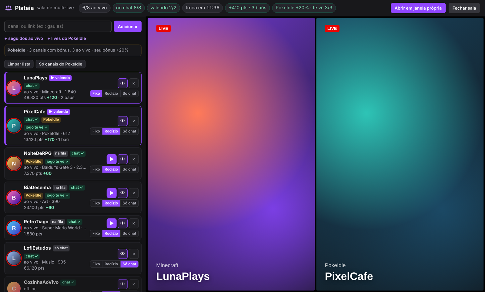
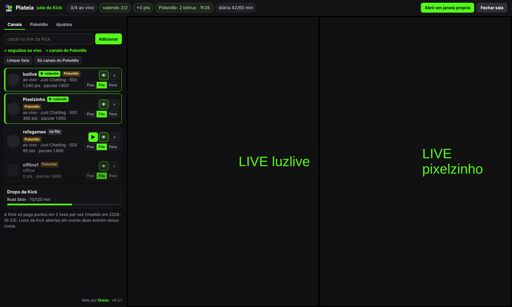
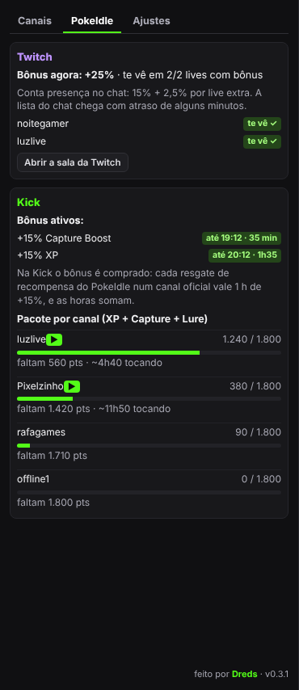

<div align="center">


# Plateia

**Your seat in every stream at once.**
A Chrome extension for **Twitch and Kick**. It grabs the Twitch channel-points chest by itself, claims finished Drops on both sites, and puts several lives in one room. On Twitch you're present in every chat; on Kick it saves channel points and redeems them for you.




<sub>The Twitch room with demo channels (simulated Twitch, made-up names).</sub>

</div>

---

## What it does

The extension knows which site it's on. **Twitch** and **Kick** each get their own room (purple button on Twitch, green on Kick), and both rooms have a **PokeIdle** tab.

### Twitch

- **Chest on autopilot.** On any Twitch tab, and on every live inside the room, it clicks the *+50* bonus chest as soon as it shows up (0.4–2 s random delay). It looks for the chest icon, not the button text, so it works in any language.
- **Drops on autopilot.** The room checks your inventory every 2 minutes. A Drop at 100% is claimed directly; if that fails, it opens the inventory page hidden and clicks *Claim* there.
- **Multi-live room.** A purple **Plateia** button on Twitch opens the room in its own window:
  - **Presence in every chat.** One IRC connection, using the site's own login, joins the chat of every channel on your list (in batches, inside Twitch's join limit). You show up in the viewer list without loading any video.
  - **2 lives that count.** Twitch only pays points and chests on 2 streams at a time, so 2 slots play for real: the full channel page in an iframe, muted, at 160p. The 👁 button hides a live without reloading it (it keeps counting).
  - **Rotation.** Slots rotate between the channels that are live every N minutes (20 by default, 10 minimum), so every channel earns at some point. Each channel can be **Fixed** (always gets a slot), **Rotation** or **Chat only**, and **▶** puts one on screen right now.
  - **Live counters:** live/total, in chat X/Y, earning 2/2, time to the next swap, points and chests since the room opened, balance per channel, Drops in progress.
- **Add channels** by name or link, from the channels you follow that are live, or from the game below.
- **PokeIdle bonus.** [PokeIdle](https://pokeidle.io) gives an XP bonus for being in the chat of its partner streams. With the game open in a tab, Plateia reads the list of bonus channels from the game itself (read only, it never sends anything to the game), keeps them on the list and shows whether the game already sees you on each one.

### Kick

Kick has no chest to click: points drop by themselves (10 every 5 minutes watched), they only work on the channel where you earned them, and only **2** lives earn at a time (measured, same as Twitch).

- **Room with 2 slots in focus mode.** The channels closest to completing a PokeIdle bundle play first, so bundles close sooner. Each channel can be **Fixed**, **Queue** or **Off**; **▶** pins one right now.
- **Bundle redemption.** When a channel's balance covers **one of each** PokeIdle reward (XP + Capture Boost + Secret Lure), it redeems the three in a row through the site's own endpoint. Guard rails: only with Kick linked inside the game, only if the game is linked to the same Kick account, only full bundles (all three rewards active), stops on the first error and waits 15 minutes.
- **Daily Reward and Drops.** Claims Kick's Daily Reward after the hour watched, and finished Drops when the game account is connected.

### PokeIdle tab





- **Twitch:** current bonus (15% + 2.5% per extra live) and which bonus lives already see you.
- **Kick:** active bonus hours (until when), bundle progress per channel with a time estimate, last redemptions.

<sub>Kick room and PokeIdle tab with demo data (simulated Kick and PokeIdle, made-up names).</sub>

> The interface is in Portuguese, the language I use.

## How it was measured

Before writing the room I measured how Twitch actually behaves, on a live account:

- The bonus chest is `.claimable-bonus__icon` inside `[data-test-selector="community-points-summary"]`, and it can be clicked from inside an iframe of the same site.
- A full `twitch.tv/<channel>` page inside an iframe on twitch.tv loads logged in and earns points. The official embed player (`player.twitch.tv`, used by most multi-stream sites) **doesn't**.
- With 4 lives open, only **2** earned points. A live in a 2×2 px iframe still earns points and chests.
- Drops progress on one channel at a time, so the room doesn't try to speed them up.
- On Kick, 4 lives playing for 11 minutes: only **2** earned points. `kick.com/<channel>` can be framed by a kick.com page, so the room works the same way.
- PokeIdle's Kick bonus is bought: each redemption of a PokeIdle reward on an official channel is 1 hour of +15%, and hours add up (from the game's own client code).

## Architecture

```
extension/
├── manifest.json            MV3: storage + alarms; hosts twitch.tv, kick.com and api.github.com
├── COMO-INSTALAR.html       install / use / update guide (PT and EN), opens on first install
├── src/fundo.js             service worker: update check against this repo's releases + reload when the folder changes
├── src/comum.js             shared: default settings, storage, cookie login, GQL helper
├── src/bau.js               every Twitch frame: clicks the chest; on the inventory page, claims Drops
├── src/sala.js              the Twitch room (shadow DOM): channel data, IRC presence, slots, rotation, Drops
├── src/kick/kick.js         Kick: button, room, focus-mode slots, bundle redemption, Daily Reward, Drops
├── src/ui.js                shared UI pieces, logo and footer signature
├── src/pokeidle-painel.js   the PokeIdle tab used by both rooms
├── src/pokeidle-ponte.js    pokeidle.io, page world: reads the game's twitch and kick blocks from its WebSocket (read only)
├── src/pokeidle-guarda.js   pokeidle.io: stores those blocks for the rooms
└── icons/
```

- No popup: everything lives inside the site. The only background piece is the small update service worker.
- Channel data comes from Twitch's own GraphQL endpoint with aliased queries, batched 10 per request (Twitch rejects more than 15 aliases).
- The room's players are forced to 160p only while they load, then your usual quality setting is restored.
- Chat presence heals itself: a JOIN that Twitch drops is retried after 30 s, every channel is re-checked each minute, and a silent chat connection is reopened after 6 minutes.
- Kick calls use the site's own login (the `session_token` cookie) from inside kick.com.

## Updates

Plateia checks this repo's latest release when Chrome starts, every 6 hours and when you press **↻ Check for updates** in either room. A new version shows a gold card with what changed and a gold dot on the Plateia button; **Update** downloads the zip, and once you extract it **over the same folder** Plateia notices the new `manifest.json` within a minute and reloads itself (only the room tabs reload; your other Twitch and Kick tabs keep running).

## Install

1. Download **plateia-vX.Y.Z.zip** from the [latest release](https://github.com/DredsGG/plateia/releases/latest) and extract it to a folder you'll keep (updates are extracted over it).
2. Open `chrome://extensions` and turn on **Developer mode** (keep it on: the self-reload after an update needs it).
3. Click **Load unpacked** and pick that folder. From a clone of this repo, load the `extension/` folder. `COMO-INSTALAR.html` opens with the illustrated steps.
4. Reload twitch.tv or kick.com and click the **Plateia** button (bottom left: purple on Twitch, green on Kick).
5. For PokeIdle, reload the game tab once after installing so Plateia can read the official channels.

## Tests

```bash
cd tests && npm i jsdom
node teste-sala.cjs         # Twitch room logic in jsdom: 27/27
node teste-kick.cjs         # Kick room: bundle, order, guard rails, Daily Reward, Drops, tab
node teste-chat.cjs         # dropped chat JOIN is retried: 3/3
node teste-assinatura.cjs   # footer signature and version: 6/6

# needs Playwright; pass a COPY of the extension folder (the test rewrites its manifest)
node e2e-atualizacao.mjs /path/to/copy-of-extension   # update flow: 10/10
```

`e2e-atualizacao.mjs` loads the real extension in Chromium against a fake GitHub release: the guide opens on install, the gold card shows the versions and notes, *Update* opens the zip, the dot appears on the button, *Later* hides it, and writing a newer `manifest.json` into the folder makes Plateia reload itself (15 s) with the green "updated" notice.

`teste-sala.cjs` covers the PokeIdle bridge and storage, GQL batching, settings migration, per-channel modes, *watch now*, removed channels not coming back, list clearing, and the footer. The room was also run end to end in Chromium with the extension loaded against a simulated Twitch and PokeIdle, and on a real account in my Chrome (chat 12/12, a chest claimed by the rotation). Claiming a real Drop at 100% hasn't been seen live yet. The Kick room was run on a real account (live status, balances, Daily Reward and Drops read, 2 lives playing); a real bundle redemption hasn't happened yet.

## Disclaimer

Personal project, not affiliated with or endorsed by Twitch, Kick or PokeIdle. It doesn't fake viewing: lives that earn points are real players playing video. Automating clicks and redemptions may still go against Twitch's or Kick's Terms of Service. Use it on your own account and at your own risk.

## License

[MIT](LICENSE) · made by [André Miller Fleck (Dreds)](https://github.com/DredsGG)
